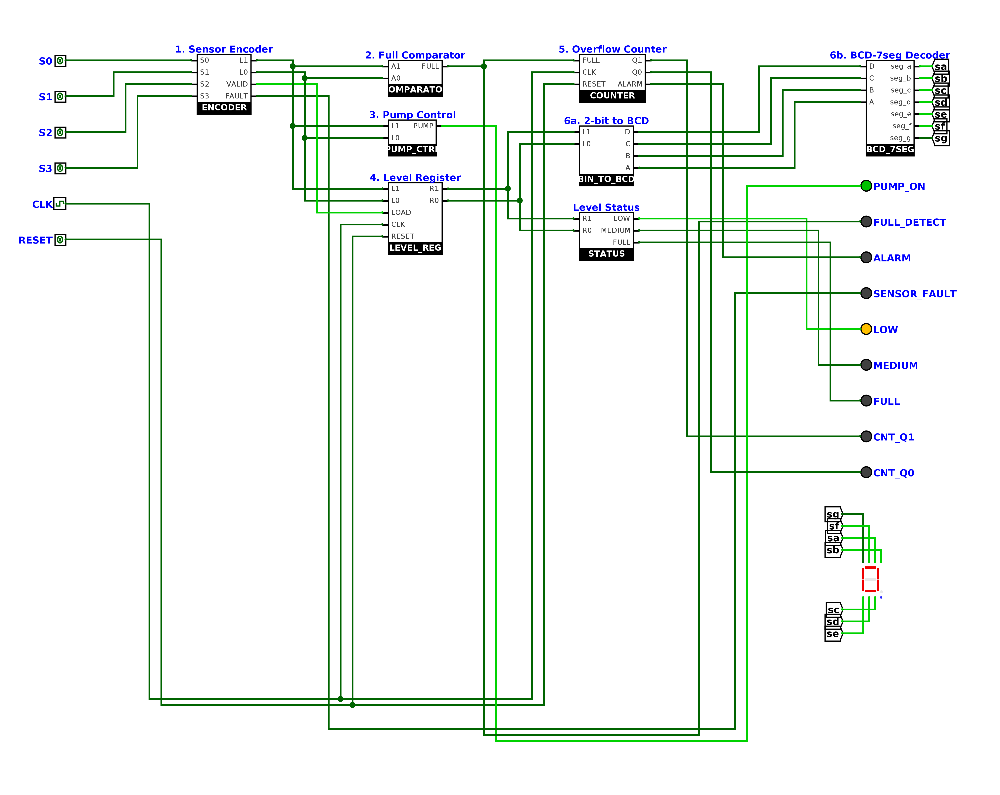
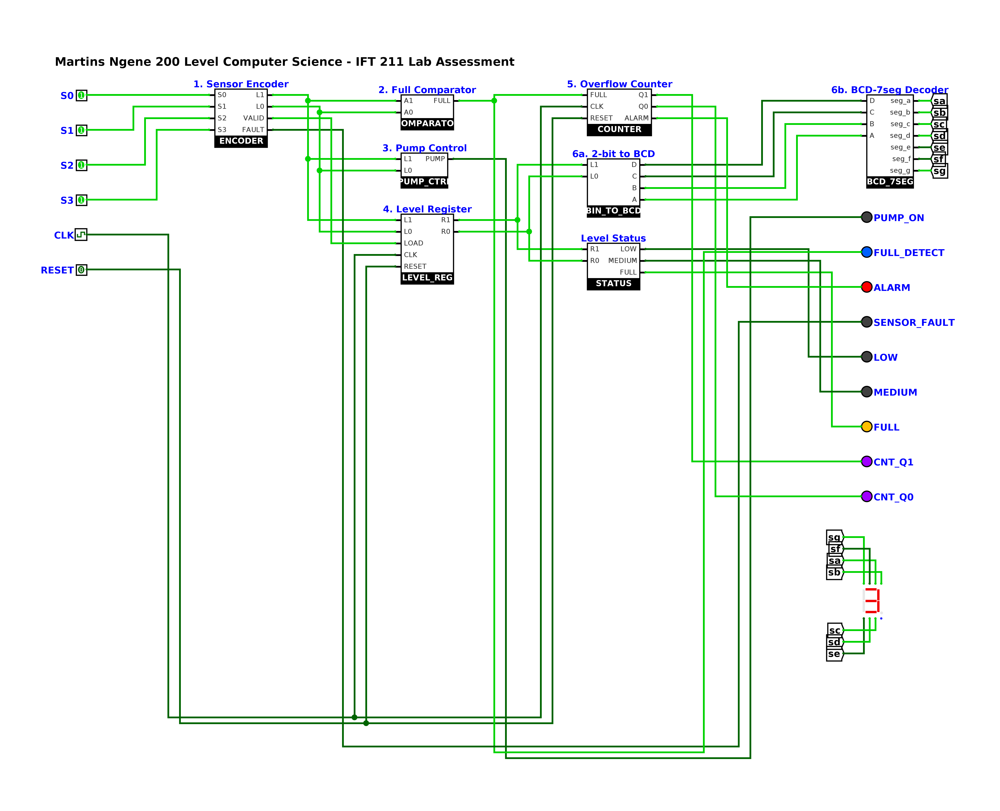

# Smart Water Tank Monitoring & Control System

IFT 211 (Digital Logic Design) mid-semester lab assessment at MIVA Open University.

| | |
|---|---|
| **Student** | Martins Ngene |
| **Programme** | B.Sc. Computer Science |
| **Repository** | [github.com/martins-ngene/ift-211-smart-water-tank-system](https://github.com/martins-ngene/ift-211-smart-water-tank-system) |

The project is a digital water tank controller built in **Logisim-evolution** from pure digital logic: basic gates, D flip-flops and a 7-segment display. It uses no microcontroller and none of Logisim's built-in encoder, decoder, comparator, counter or register blocks.

## What it does

- Reads four water-level sensors: S0 (empty), S1 (25%), S2 (50%) and S3 (100%).
- Shows the tank level (0–3) on a 7-segment display.
- Lights a LOW, MEDIUM or FULL indicator.
- Turns the pump **on** while the tank is below FULL and **off** as soon as it is FULL.
- Raises an **ALARM** if FULL stays high for 3 clock cycles (overflow risk).
- Stores the last valid level in a clocked register and flags impossible sensor patterns as `SENSOR_FAULT`.

## Files

| Path | Description |
|---|---|
| `SmartWaterTank_Martins_Ngene.circ` | Logisim-evolution circuit file (main circuit + 8 gate-level sub-circuits) |
| `screenshots/` | Circuit and simulation screenshots, the simulator test log (`sim_log.txt`) and Logisim-generated truth tables (`tty_tables.txt`) |

> The submission report (PDF with derivations, truth tables, K-maps and test results) is submitted separately through the MIVA portal and is not tracked in this repository.

## Design summary

| Stage | Sub-circuit | Logic |
|---|---|---|
| 1. Sensor encoder | `ENCODER` | `L1 = S3 + S2`, `L0 = S3 + S2'·S1`, `FAULT = S3·S2' + S2·S1' + S1·S0'`, `VALID = FAULT'` |
| 2. Full comparator | `COMPARATOR` | XNOR equality comparator against `11`: `FULL = L1·L0` |
| 3. Pump control | `PUMP_CTRL` | `PUMP = (L1·L0)'` (one NAND gate) |
| 4. Level register | `LEVEL_REG` | 2 D flip-flops with load/hold: `Di = LOAD·Li + LOAD'·Qi`, async RESET |
| 5. Overflow counter | `COUNTER` | 2-bit synchronous saturating counter: `D1 = FULL·(Q1+Q0)`, `D0 = FULL·(Q1+Q0')`, `ALARM = Q1·Q0` |
| 6a. Binary → BCD | `BIN_TO_BCD` | `D = C = 0`, `B = R1`, `A = R0` |
| 6b. BCD → 7-segment | `BCD_7SEG` | Full BCD decoder from K-maps with don't-cares for codes 10–15 |
| Status | `STATUS` | `LOW = R1'`, `MEDIUM = R1·R0'`, `FULL = R1·R0` |

## How to run

1. Install [Logisim-evolution](https://github.com/logisim-evolution/logisim-evolution/releases) 3.9.0 or newer. On macOS you can also run `brew install --cask logisim-evolution`.
2. Clone the repo (`git clone https://github.com/martins-ngene/ift-211-smart-water-tank-system.git`) or download `SmartWaterTank_Martins_Ngene.circ`, then open it in Logisim-evolution with **File → Open**.
3. Select the Poke tool (hand icon). Set **RESET** to 1, then back to 0.
4. Start the clock with **Simulate → Auto-Tick Enabled** (Ctrl/⌘+K), or step it one tick at a time with Ctrl/⌘+T.
5. Poke S0 → S3 to fill the tank. The display counts 0 → 3, and the pump switches off at FULL. ALARM lights after 3 clock edges.
6. Clear S3 to simulate draining. Try S2 = 1 with S1 = 0 to see `SENSOR_FAULT` while the display holds the last valid level.

## Testing

- **Combinational sub-circuits:** exhaustive truth tables were generated with Logisim's `--toplevel-circuit <name> -t table` mode. All of them match the designed tables.
- **Full system:** a 17-step clocked scenario covered reset, filling, the 3-cycle alarm, draining, a sensor fault and async reset. Every step passed; see `screenshots/sim_log.txt`.

